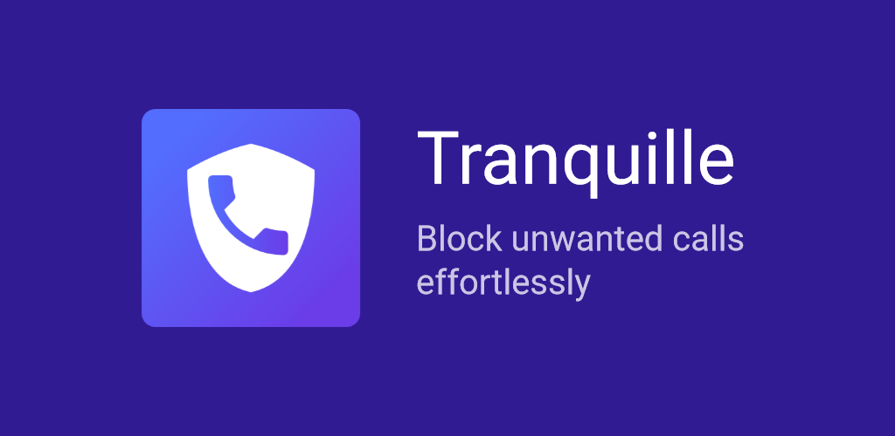

      
      

# Tranquille (kusznier fork)

A free and open source application that blocks unwanted calls or warns about the probable intentions of callers, using a third-party crowdsourced phone number database (from some other proprietary app).

**This is a personal fork** of [Tranquille](https://github.com/Vinetos/Tranquille) by Vinetos, which is itself a fork of [Yet Another Call Blocker](https://gitlab.com/xynngh/YetAnotherCallBlocker) by xynngh. It keeps the same app name and package (`fr.vinetos.tranquille`) and the same database and servers. See [what changed in this fork](#what-changed-in-this-fork).

**Disclaimer:** This is a free and open source project, but it relies on third-party web services for some functions to work. This project is not affiliated with any third-party entities in any other sense.

## Install

Signed APKs are published as [GitHub releases](https://github.com/kusznier/Tranquille/releases).

* With [Obtainium](https://github.com/ImranR98/Obtainium): add `https://github.com/kusznier/Tranquille`. It installs the latest release and offers updates. Pre-releases are test builds; Obtainium skips them unless "Include prereleases" is on.
* By hand: download `tranquille-vX.Y.Z.apk` from the latest release. The release notes list the SHA-256 of the APK and of the signing certificate.

Requires Android 7.0 or newer. The APK is signed with this fork's key, so it cannot update an install of the original Tranquille or of YACB; both can stay installed, but only one app can hold the call screening role.

## How to use

* Launch the app and allow the requested permissions (phone, call log, notifications).
* The card at the top of the main screen shows whether protection is on, or the one thing that is missing with a button to fix it: download the number database (about 25 MB, from [another GitLab repository](https://gitlab.com/xynngh/YetAnotherCallBlocker_data)), set Tranquille as the caller ID and spam app ("Advanced call blocking"), or allow notifications.
* Turn on "Block based on rating" in that card to block calls with a negative rating.
* Add numbers or patterns (`*` any digits, `#` one digit) to the denylist, or import a CSV backup from YACB, Tranquille or NoPhoneSpam.
* Automatic database updates, contacts, the theme and everything else are in Settings.

See [frequently asked questions](FAQ.md) to learn more.

## What changed in this fork

* The whole interface is rewritten in Jetpack Compose with Material 3 Expressive (dynamic color, dark theme, edge to edge), with a status card on the main screen, denylist search, undo for deletions and an import summary.
* Denylist fixes: adding a new entry no longer overwrites the previous one, importing a backup no longer creates duplicates or overwrites entries by id, entries without a name are saved, and the NoPhoneSpam import no longer crashes.
* The notification permission is requested on Android 13+, and the call screening role can be requested from the main screen.
* Notifications show the category and the number of negative and positive ratings from the offline database.
* Optional (off by default): online reviews for blocked calls, see [Privacy](#privacy).
* No dependency is downloaded from JitPack: LibPhoneNumberInfo is included as source in [`libs/`](libs/README.md) and SQLite is the platform one.
* Build with AGP 9, Kotlin 2.4, compileSdk 37.1; JVM unit and UI tests; GitHub Actions builds every push and publishes signed releases.

See the [changelog](CHANGELOG.md) for details.

## More on features

At this point most of the essential features (one would expect from a call blocking app) are implemented. Here's an overview:

* Automatic blocking of calls with negative rating, calls from hidden or locally denylisted numbers. *Works offline.*  
  Call blocking should work on most Android versions (including Android 10).  
  Some phones (like some Xiaomi) [require](https://gitlab.com/xynngh/YetAnotherCallBlocker/-/issues/12) to enable "Advanced call blocking mode" or a monitoring service.
* Local denylist with wildcard support.  
  Import of NoPhoneSpam backup is supported.
* Showing a notification with some caller info (positive/negative rating, category, number of negative reviews and such) when the phone's ringing. *Works offline.*
* Loading and displaying a list of reviews for a number (accessed from the notification or the info view). *Requires internet.*
* Automatic update of the database (for offline use). *Requires internet.*
* Displaying call log with caller rating and the ability to show more info or load online reviews for the number. The list *works offline*, but loading reviews *requires internet.*
* If "use contacts" option is enabled, the numbers present in the phone book are never blocked and the contact name is displayed next to/instead of a number throughout the app.
* "Advanced call blocking mode" for blocking calls on Android 7+ before the phone starts ringing.  
  Needs to be manually enabled in app Settings.

## Privacy

Protecting the user's privacy is the first concern during development. No personal data is sent to or otherwise shared with anyone. The app never sends your own phone number, IMEI, Android ID or real device model. All network requests are listed below (checked in the source of this fork and of LibPhoneNumberInfo):

* Downloading the main database (only when you start it): a plain request to `gitlab.com`.
* Database updates (daily if enabled, or by hand) go to `aapi.shouldianswer.net` and leak your IP address.
  The request also includes the current database version, a country code (auto-detected or set manually),
  a random app id that changes every few minutes and a fixed fake device model.
* Online review requests go to the same server and leak your IP address coupled with the phone number in question,
  plus a country code. They are only sent when you open "Online reviews".
  If the "use contacts" feature is enabled, a confirmation dialog is shown if online reviews are requested for a number present in your phone book.
* Optional, off by default: "Online reviews for blocked calls" loads the reviews of a call right after it was blocked
  (never for contacts) to add the most common reason to the notification. This sends the blocked number, like opening "Online reviews" by hand.
* "Add review (web)" opens the number on the review website in your browser.

No other identifiable information is sent with the requests. The call log, contacts and denylist stay on the device.

## Available data

The following data is available in the main offline database:

* a phone number,
* a category (telemarketers, dept collectors, scam, etc.),
* a number of negative reviews,
* a number of positive reviews,
* a number of neutral reviews.

The main database may receive delta updates from third-party servers.

The "featured" database provides "names" (company names or short descriptions) for some (presumably) subset of numbers in the main database.

The third-party servers can be queried for a list of detailed user reviews for a specific phone number.
A detailed review contains:

* A rating: positive, negative or neutral.
* A category: each review may have a different one.
* A title and a comment: the actual description the user left for the number.

## Rationale

Some may find the original application (whose DB and servers are used) hard to trust because of its proprietary nature (and also the use of firebase analytics and the like).  
But since the database behind that application is crowdsourced, some may find it acceptable (in a moral sense) to use that database in a separate open source application.  
Also, this project is meant to be non-commercial. So, there's that.

## License

[AGPLv3-only](https://www.gnu.org/licenses/agpl-3.0.en.html), like the projects this fork is based on.
Copyright of the original code stays with its authors (xynngh, Vinetos and contributors); changes in this fork are listed in the [changelog](CHANGELOG.md) and the git history.

## Contributing

This fork is maintained for personal use. Bug reports are welcome in [issues](https://github.com/kusznier/Tranquille/issues).
For the original project see [Tranquille](https://github.com/Vinetos/Tranquille) and [Yet Another Call Blocker](https://gitlab.com/xynngh/YetAnotherCallBlocker).

## Building

See [BUILDING.md](BUILDING.md).
